## [100KSPS 8-bit Fully-differential Successive Approximation Register (SAR) analog-to-digital converter (ADC) for Low-power Applications](https://repositories.efabless.com/kithminrw/IC2-CASS-2024) - [Universalization of IC Design from CASS](https://github.com/unic-cass)

> ### Summary, results and contributions
>
> **Status:** this design was submitted for the IEEE UNIC-CASS 2024 tapeout (Caravan, SkyWater SKY130) but was **not fabricated** because Efabless, which ran the shuttle, shut down before fabrication. All results are from simulation.
>
> **Tools:** Xschem and ngspice (schematic and simulation), Magic (custom layout), Netgen (LVS), OpenROAD/OpenLane (SAR logic).
>
> The original proposal and target specification are kept below for reference; the target values are design goals, not achieved results.

## Layout

Custom layout of the CDAC and its switches was drawn in Magic (SKY130). The digital SAR logic was placed and routed with OpenROAD. Layout files are in `test/Layout/`.

#### Binary-weighted CDAC (Magic)

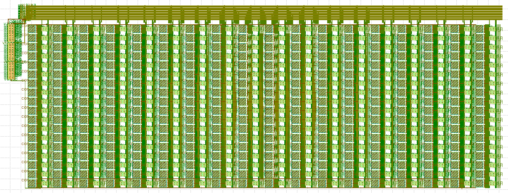

<em>Binary-weighted capacitor DAC with its switch array (<code>test/Layout/capdac_p_layout</code>).</em>

| Capacitor and switch unit cell | Sampling transmission-gate switch |
|:---:|:---:|
| 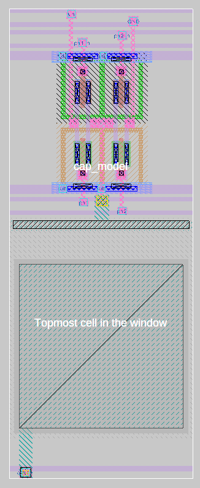 | 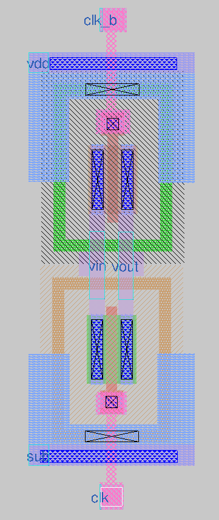 |
| Capacitor-switch block layout (<code>test/images/cap_switch_block_layout.png</code>) | Transmission-gate sampling switch (clk / clk_b) |

#### SAR logic (OpenROAD, sky130_fd_sc_hd)

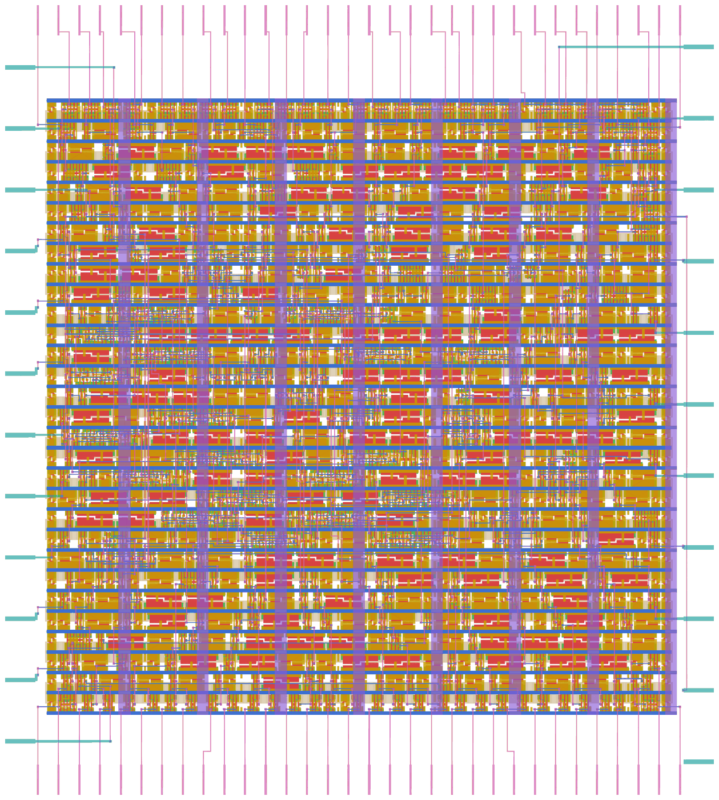

<em>Place-and-route result of the digital SAR logic (roughly 95 × 105 µm including pin stubs), rendered from <code>verilog/sar_digital.gds.gltf</code>. Colours: li1 gold, met1 blue, met2 pink, met3 teal, met4 purple, poly red, diffusion green.</em>

The comparator layout (Kithmin) and the final top-level assembly are not included in this repository.

## Block schematics

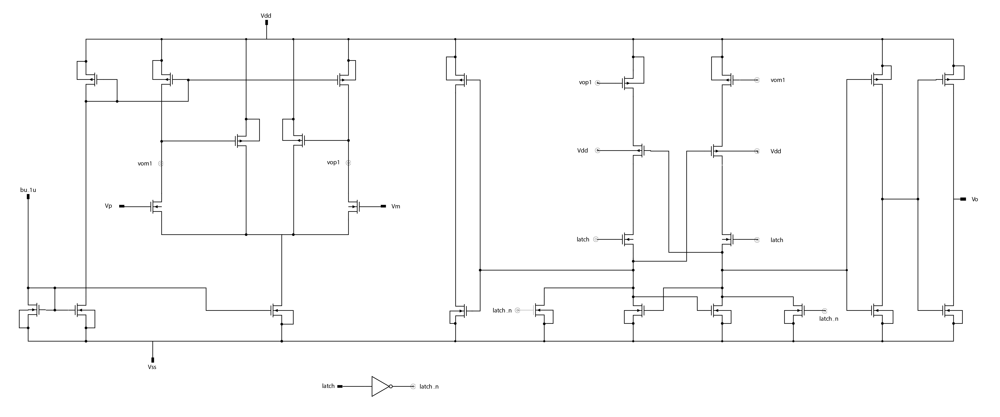

<em>Comparator: differential pre-amplifier, regenerative latch (latch / latch_n) and output stage, biased from a 1 µA reference (bu_1u).</em>

<em>SAR controller: a shift-register chain of D flip-flops generating the sampling and bit-decision phases (smpl, d0–d7, data_rdy) from clk, rst_n and comp_out.</em>

| Differential CDAC (binary-weighted) | Transmission-gate switch |
|:---:|:---:|
|  |  |
| Two 9-capacitor arrays (Vip/Vref and Vin/Vref) with Vcm sampling switches | NMOS and PMOS pair, W/L = 1 µm / 0.15 µm each |

## Simulation results (Xschem and ngspice, schematic level)

These are schematic-level simulations. No post-layout or silicon results exist for this design.

#### Sub-blocks

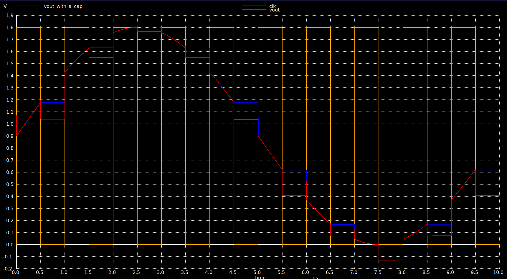

<em>Transmission-gate sampling switch: output (vout) tracking and holding the input on the sampling clock.</em>

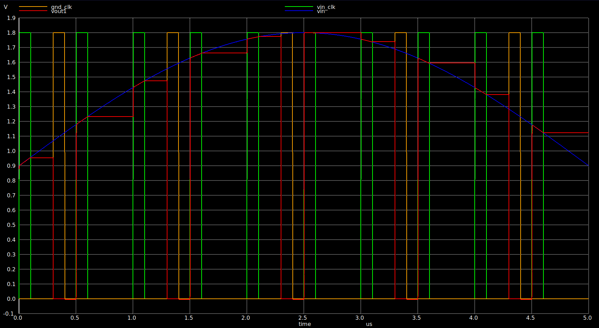

<em>Capacitor-switch unit cell: input sine (vin), the two phase clocks and the sampled output (vout1).</em>

#### CDAC with comparator and SAR logic

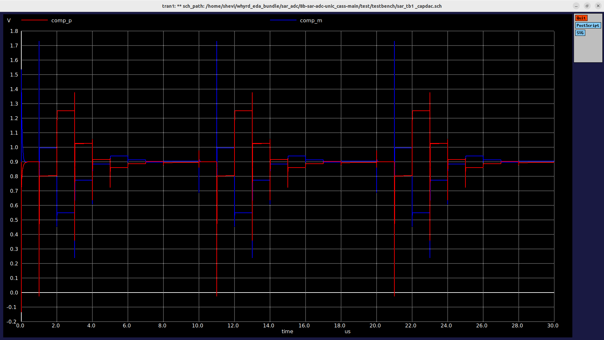

<em>Comparator inputs (comp_p, comp_m) across three conversions with the CDAC testbench <code>sar_tb1 _capdac</code>: the two nodes step towards each other as the bits are resolved and settle near the 0.9 V common mode.</em>

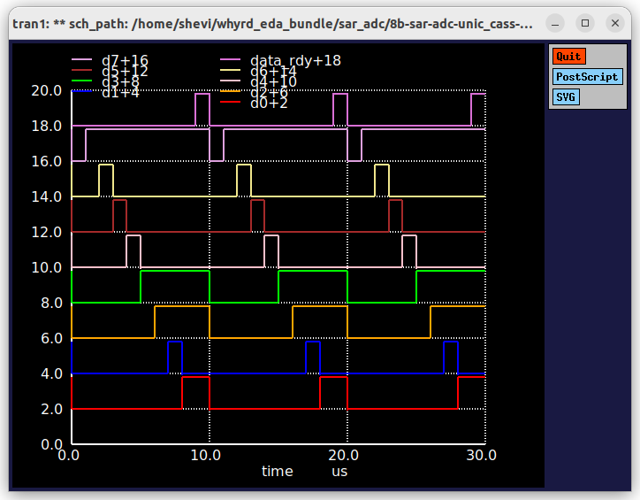

<em>Output bits d0–d7 and data_rdy for the same run, shown over three conversions (each trace is offset vertically for readability).</em>

#### Full-array testbenches (<code>test/testbench</code>)

| Output bits with <code>capblock_256</code> (<code>sar_tb_replace_cblock256</code>) | Output bits with the full block (<code>sar_tb_replace_total_block</code>) |
|:---:|:---:|
| 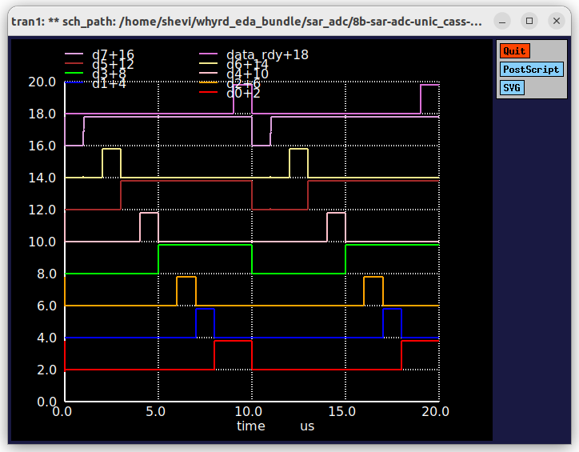 | 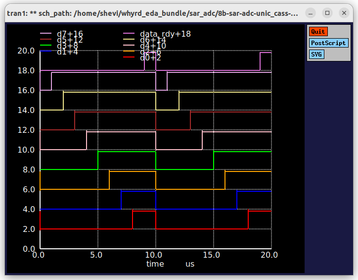 |

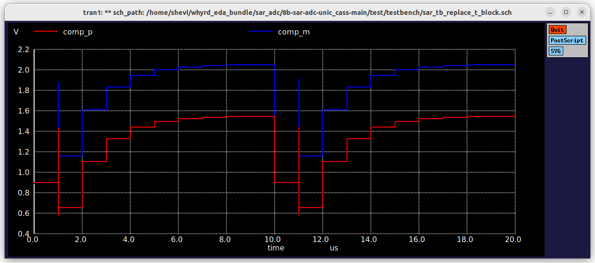

<em>Comparator inputs (comp_p, comp_m) over two conversions with the <code>sar_tb_replace_t_block</code> testbench.</em>

More captures and the testbenches themselves are in [`test/images`](test/images) and [`test/testbench`](test/testbench).

#### Contributors and roles

| Contributor | Role |
|---|---|
| Lohan Atapattu | Schematic design and simulation, SAR logic layout (OpenROAD) |
| Sajitha Madugalle | Schematic design and simulation |
| Hirusha Maduwantha | Schematic design and simulation |
| **Imasha Nethmal** | **Schematic design and simulation, Layout** |
| Kithmin Wickremasinghe | Layout (comparator) and tapeout submission |
| Erandee Jayathilaka | SAR logic development (digital) |

---

### 1. Team Members (Department of Electronic and Telecommunication Engineering, University of Moratuwa)

- Sajitha Madugalle.
- Imasha Nethmal.
- Lohan Atapattu.
- Erandee Jayathilaka.
- Hirusha Maduwantha.
- Udara Mendis (MASc reading).
- Kithmin Wickremasinghe (MASc).
- Dr. Nilan Udayanga (PhD).

### 2. Overview of the Project:

 Introduction: We propose to design a 100 KSPS 8-bit successive approximation register (SAR) ADC for low-power applications such as battery-powered or RF-powered internet-of-things (IoT) devices and wearable/implantable medical devices. Our main goal is to achieve 8-bit resolution while minimizing power and die area consumption. Walden figure-of-merit (FoM) will be utilized to quantify the performance of the ADC. The choice of the SAR ADC for the UNIC-CASS program will enable us to master both analog and digital design techniques while providing practical experience with relevant tools. Additionally, designing the SAR ADC layout will teach us crucial layout methods, such as common centroid and noise reduction techniques.

 Scope: Considering the limited timeline and the experience level of undergraduate students, we have proposed a challenging but feasible scope for the project. The SAR ADC will be a fully-differential design with external input and reference provided, as illustrated in Fig. 1. External low-noise buffers will be used to buffer the input signal and reference voltage. The 8-bit DATA[7:0] output will be captured from an external data capture unit when the DATAREADY signal is asserted. Both AVDD and DVDD supplies (typical 1.8 V) are provided externally, along with an external 1 MHz clock.

 Architecture: The architecture of the SAR ADC, shown in Fig. 2, includes two capacitor arrays, a comparator, and digital SAR logic. It utilizes binary-weighted capacitor arrays with charge redistribution architecture. The comparator comprises a pre-amplifier followed by a regenerative latch. The pre-amplifiers offset is auto-zeroed before every sample. After each conversion, the DATAREADY signal is asserted to notify the external data acquisition circuit to capture the available data. If time permits, we will introduce asynchronous logic for the SAR logic block to increase the sampling rate. 

### 3. Block diagram of the project

**Figure 1** – SAR ADC Block Diagrams.

### 4. Specification table

| Specification           | Min                 | Typ     | Max    | Unit   | Comments|
|-------------------------|---------------------|---------|--------|--------|---------|
| Supply voltage (Design Input)| 1.7 | 1.8 | 1.9 | V | - | 
| External clock frequency (Design Input)| - | 1 | - | MHz | - | 
| Resolution | - | 8 | - | bits | - | 
| Operational Temperature | 10 | 36 | 45 | C | - | 
| Reference voltage (Design Input)| - | 0.8 | - | V | - | 
| Temperature (Design Input) | 20 | - | 50 | C | - | 
| ENOB | 7.5 | - | - | bits | - | 
| INL | -0.5 | - |  0.5 | LSBs | - | 
| DNL | -0.5 | - | 0.5 | LSBs | - | 
| SFDR | 55 | - | - | dB | - | 
| Sampling rate | 100 | - |  - | ksps | - | 
| Current consumption during conversion | - |  - | 20 | uA | - | 
| Power down current consumption | - | - | 100 | pA | - | 
| Die area | - | - | 0.25 | mm² | 500 um x 500 um | 
| FoM | - | - | 200 | fJ/conversion-step | Walden figure-of-merit (FoM) | 

**Table 1** – SAR ADC performance.

## Pin Layout

| # | Pin Name         | I/O                 | Description |
|---|------------------|---------------------|-------------|
| 00 | vccd | - | - | 
| 01 | vddio | - | - | 
| 02 | mprj_io[37] | - | - | 
| 03 | mprj_io[36] | A_Data[0] | Output | 
| 04 | mprj_io[35] | A_Data[1] | Output | 
| 05 | mprj_io[34] | A_Data[2] | Output | 
| 06 | mprj_io[33] | A_Data[3] | Output | 
| 07 | mprj_io[32] | A_Data[4] | Output | 
| 08 | vssd2 | DVSS | - | 
| 09 | vdda2 | AVDD | - | 
| 10 | mprj_io[31] | A_Data[5] | Output | 
| 11 | mprj_io[30] | A_Data[6] | Output | 
| 12 | mprj_io[29] | A_Data[7] | Output | 
| 13 | mprj_io[28] | data_rdy | Output | 
| 14 | mprj_io[27] | clk | Input | 
| 15 | mprj_io[26] | rst_n | Input | 
| 16 | mprj_io[25] | comp_out | Output | 
| 17 | vssa2 | AVSS | - |
| 18 | vddio | - | - |
| 19 | vccd2 | DVDD | - |
| 20 | mprj_io[24] | ibias_1u | Analog Input | 
| 21 | mprj_io[23] | Vrefp | Analog Input | 
| 22 | mprj_io[22] | Vinp | Analog Input | 
| 23 | mprj_io[21] | Vcm | Analog Input | 
| 24 | mprj_io[20] | Vinm | Analog Input | 
| 25 | mprj_io[19] | Vrefm | Analog Input | 

**Table 2** – Caravan SKY130 pin mapping.

Refer to [README](docs/source/index.rst) for this sample project documentation. 
